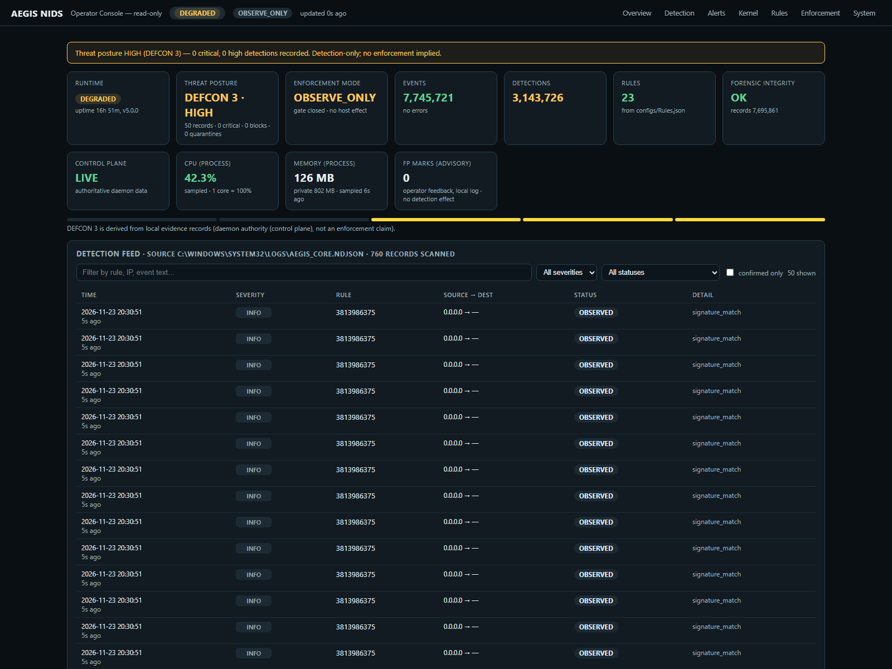

# AEGIS Kernel NIDS for Windows

[](https://github.com/Supertee003/NIDs_Windows/releases/tag/v1.1)
[](docs/portfolio/ARCHITECTURE_EN.md)
[](LICENSE)

AEGIS is a Windows-native, kernel-assisted network intrusion detection system. It combines kernel network telemetry, host telemetry, rule matching, policy evaluation, operator control, and forensic evidence in one supervised runtime. Production behavior is detection-only: findings are recorded and explained, not applied as host blocking or quarantine.

> **Release status:** The repository is maintained with production-oriented contracts, authority boundaries, runbooks, and acceptance gates. The current release is approved for development, qualification, and observe-only operation. Enforcement activation is permanently outside the production product scope; historical IPS/WFP proof material is retained only as historical or lab evidence.
>
> **Canonical scope lock:** [`docs/SCOPE.md`](docs/SCOPE.md) — **AEGIS Kernel NIDS, detection-only / observe-only**, no production fleet deployment before qualification, no automatic blocking, no process termination, no host isolation, no IPS claim. It applies to this README, runtime, capability manifest, operations guide, demo and release notes. Status always comes from [`release/release-status.json`](release/release-status.json), never from a copied gate count.

## AEGIS in 60 seconds

**Windows-native, kernel-assisted Network Intrusion Detection System — detection-only.** AEGIS
watches real Windows network and host activity, normalizes it into one canonical event format,
matches 23 rules, records a policy decision as evidence, and writes hash-chained forensic records.
It records and explains findings; it never blocks, quarantines, or mutates the host.



*Live, read-only operator console on the lab host. This snapshot reports `runtime=DEGRADED`;
the `responder state DEGRADED` line is the control API echoing that daemon health state
(`tools/aegisctl/api/control_api.py:974-980`), not an independent root cause. All runtime
subsystems report `RUNNING` and the console shows authoritative daemon data.*

| Question | Answer |
|---|---|
| What does it do? | Packet capture → canonical event → detect → policy evidence → forensic record → operator view |
| Why is it interesting? | One runtime spanning six language families with a strict boundary: no layer may promote "detected" into "blocked" |
| Stack | Zig runtime spine · Go packet acquisition · C/C++ Windows adapters (C and C++ are two toolchains in one family) · Rust detection-only PEP + crypto · Python analytics · TypeScript advisory policy authoring (no runtime artifact) |
| Scale | 23 detection rules across L4, L7, kernel file/process, and pipe layers; 12M+ events observed on the current lab host ([measured values](docs/portfolio/OBSERVED_PERFORMANCE.md)) |
| Proof | [`v1.1` release](https://github.com/Supertee003/NIDs_Windows/releases/tag/v1.1) — **published immutable identity only (HISTORICAL relative to current source):** SHIPPABLE, **6/6 gates PASS (0 open)**, 36.52 h owner-run soak PASS, 674/674 artifact hashes verified against **one** Ed25519 signature over `SHA256SUMS`; 1,471 Python tests (two-phase run at build source `a53eda8`, 0 skipped). `open=0` means zero gates open, not zero gates passed. Single source of status: [`release/release-status.json`](release/release-status.json); scope: [`docs/SCOPE.md`](docs/SCOPE.md) |
| Boundary | observe-only; prevention gate closed; `host_effect_capable=false`; no WFP enforcement in production |

> **Current source vs published release.** The `v1.1` proof row above is the immutable published
> release identity (`466a226` / `a53eda8`). The current build source is `aa3b7b0`; its additive
> signed record is `release/T20-final/6c94b47`, and the current-source board is **5/6 PASS with
> `soak_24h` OPEN — NOT SHIPPABLE**. Narrow `aa3b7b0` proofs cover the loopback E6 pair, S2
> replay denial, S3 durable identity and a 100/s loopback load; no full Windows E5, soak, driver
> or E7 claim is made. Details:
> [`analysis/current-head/CURRENT-HEAD-CLOSEOUT-AA3B7B0-20261126.md`](analysis/current-head/CURRENT-HEAD-CLOSEOUT-AA3B7B0-20261126.md).

*Counting convention: "six language families" groups C and C++ as one adapter family. The
repository contains seven language toolchains (Zig, Go, C, C++, Rust, Python, TypeScript);
TypeScript is advisory-only and emits no production artifact.*

**Watch the 2:27 demo:** [Traffic → Event → Detection → Dashboard → Forensic Record](docs/portfolio/DEMO.md) · [MP4](docs/portfolio/images/demo.mp4)

**Go deeper:** [Architecture explained in English](docs/portfolio/ARCHITECTURE_EN.md) · [Resume project section](docs/portfolio/RESUME_PROJECT.md) · [Evidence index](EVIDENCE_INDEX.json)

### Scope and status, in one table

This table is the answer to "is it an IDS or an IPS, and is blocking implemented, planned, or
deliberately out of scope?" No implementation claim here implies a production host effect.

| Area | Implemented | Verified | Production scope |
|---|---|---|---|
| Zig runtime / event pipeline | Yes | Build, unit/integration tests, Windows E5 lab | Yes — runtime owner |
| Go Nose packet ingress | Yes | Build + Windows E5 capture preflight | Yes — acquisition only |
| C/C++ WFP / ETW / FIM / Registry adapters | Yes | Observe-only E5 lab proofs for WFP and host-file/FIM telemetry; ETW/Registry coverage is per host profile; other families have synthetic fixtures only | Yes — telemetry evidence |
| Detection rules (23) | Yes | 23/23 catalog + fixture-level pins; live positive proof on L4/R9006 with negative control; R2003 command-line producer narrow E5 at `aa3b7b0`; full matrix not re-measured | Yes — detection only |
| Correlation / forensics / evidence receipts | Yes | Hash-chain verification on the current host | Yes — evidence only |
| Release v1.1 | Yes | One Ed25519 signature over `SHA256SUMS`; 674/674 artifact hashes verified; 36.52 h soak PASS | Published, immutable |
| Host blocking / WFP mutation / quarantine | Lab-only historical code | Lab qualification only | **Out of scope — not planned, not enabled** |

### Known limitations — read before the proof numbers

- No production host enforcement; the system is detection-only and observe-only.
- L7 inspection is limited by current packet visibility; TLS payloads are not plaintext-inspected.
- TCP stream reassembly is implemented but has no production caller; do not claim session-level reassembly.
- Detection rule live-validation coverage is partial: the recorded census is 22/23 host-evaluable; R2003 was re-measured on the host at `aa3b7b0` (narrow E5), but the full matrix was not.
- Control IPC now enforces nonce/replay at the source; exact replay denial has narrow E5 proof at `aa3b7b0`, not a full matrix proof.
- Windows compatibility is limited to the tested configurations; no current-source full WFP E5 result is claimed.
- No fresh 24 h soak exists at `aa3b7b0`; four attempts carry no credit (three voids plus the real `225843` FAIL with a mid-window runtime swap) and the board remains NOT SHIPPABLE.

Full list with evidence boundaries: [Known limitations and open work](#known-limitations-and-open-work).
Disposition of the remaining gaps — physical proof versus `CLOSED as documented gap`:
[`REMAINING-GAPS-DISPOSITION-AA3B7B0-20261126.md`](analysis/current-head/REMAINING-GAPS-DISPOSITION-AA3B7B0-20261126.md).
Status source: [`release/release-status.json`](release/release-status.json).

### Detection coverage — what is and is not proven

| Claim | Status | Boundary |
|---|---|---|
| Rule catalog | 23/23 rules have `match_pattern`, `regex_pattern`, a fixture vector, and a shared rule-ID hash | rule-ID census pinned by `tests/security/test_detection_contract_pin.py`; lab attack scripts are opt-in and skipped on a fresh clone |
| Code-path evaluable | 23/23 | Zig evaluates `match_pattern`; Python `regex_pattern` is advisory Tier-2 analytics |
| Host-evaluable | 22/23 | Recorded census at the measured host, where R2003 was blocked by FN-1: ProcessStart v0–v4 carry no `CommandLine`. Since `493648f` a read-only producer recovers it, and at `aa3b7b0` it has narrow E5 host proof; this census is not a new matrix result |
| Synthetic proof | 23/23 at fixture level | E1/E2 pins only — not a claim of detection efficacy on live traffic |
| Live host-positive proof | L4 family only; strongest on R9006 with a 40-port positive and 10-port negative control | one lab host/interface; loopback is a self-test binding |
| Known gap | R2003 (PowerShell cradle) FN-1 on the recorded host | process telemetry has no `CommandLine` field in v0–v4; the read-only `NtQueryInformationProcess` producer has narrow E5 host proof at `aa3b7b0`, so the remaining gap is the un-re-measured full matrix |

A synthetic fixture and a live detector firing are different evidence levels. There is no
authoritative MITRE ATT&CK mapping in this repository. Details:
[detection catalog](docs/portfolio/DETECTION_CATALOG.md),
[23-row current-source matrix](docs/portfolio/DETECTION_MATRIX_CURRENT.md), and
[source audit](analysis/current-head/SOURCE_AUDIT-20261123.md).

### Operator surfaces and preflight

AEGIS provides one unified operator control surface backed by the authenticated
Zig control daemon; the operator surfaces do not create a second runtime
authority. The fail-closed preflight, exact commands and state-reading rules
live in [`docs/operations/OPERATOR_COMMANDS.md`](docs/operations/OPERATOR_COMMANDS.md),
and detailed build/run steps in [`docs/operations/QUICK_START.md`](docs/operations/QUICK_START.md).

The **historical `v1.1` release-gate operator state** (not the current board) was:

| Area | Status |
|---|---|
| Runtime | `RUNNING` |
| Runtime readiness | `READY` |
| Canonical authority | `rust_pep` |
| Authority invariant | `HELD` |
| Prevention gate | `CLOSED` |
| Enforcement mode | `DETECTION-ONLY` |
| Provider ready | diagnostic capability only |
| Host effect capable | `false` |
| Host effect | `NOT_PROVEN` |
| Forensic integrity | `OK` |
| Forensic verification | `true` |

**Current lab-host observation (2026-11-23):** the live daemon reports `runtime=DEGRADED`
while all subsystems report `RUNNING`. The diagnostic line `responder state DEGRADED` is produced
by the control API from the daemon's own health state
(`tools/aegisctl/api/control_api.py:974-980`); it reports the state rather than causing it.
The prevention gate remains closed and `host_effect_capable=false`. That is the state shown,
unchanged, in the screenshot above. The specific counter that triggered demotion in this
snapshot was not preserved in the cited evidence; do not infer one, and do not read this
badge as a release-gate result. See the [failure matrix](docs/OPERATIONAL_FAILURE_MATRIX.md) and
[observed runtime values](docs/portfolio/OBSERVED_PERFORMANCE.md) for the exact counters and the
distinction between a release-gate result and a current host observation.

All operator surfaces consume the daemon-owned snapshot. Process scans are
diagnostic-only and are not promoted to runtime truth when the control daemon
is available. Local logs may provide forensic detail but do not override the
authoritative control response.

In historical lab qualification, a policy action such as `BLOCK` represents
an intended policy decision. It must not be displayed as a confirmed host
block unless a valid, receipt-backed postcondition contains
`status=ENFORCED` and `host_effect_confirmed=true`. Production never opens
the prevention gate, so this receipt path is not reachable in the shipped
runtime.

The current release is an observe-only, fail-closed Kernel NIDS release.
Production host enforcement is not a pending feature; it is outside the product scope.

This README is the official entry point for developers, reviewers, lab operators, and release operators. It describes the production reference architecture, the current verified detection path, the required deployment controls, and the evidence needed to operate the Kernel NIDS safely. It distinguishes source implementation, diagnostic provider readiness, and actual host effect; provider readiness never opens the production prevention gate.

## What AEGIS does

The current runtime is designed around explicit authority boundaries:

```text
Network / host activity
        |
        +--> WFP, ETW, FIM, Registry and Go Nose sensors
        |
        +--> Zig daemon and canonical event pipeline
        |
        +--> Detection, correlation and Rule-22 qualification
        |
        +--> Policy decision
        |
        +--> Rust PEP policy assessment (evidence only)
        |
        +--> WFP telemetry provider (host effect is lab-only, not production)
        |
        +--> Forensic record, audit trail and operator views
```

The Zig daemon is the runtime owner. Production Rust PEP evaluates policy and returns an assessment for evidence; it does not authorize a host effect. The user-mode WFP adapter and kernel WFP callout retain historical lab-only mutation code, but a production build has **no reachable host-effect creation path** (source call-graph reading, E1 — see the [source audit](analysis/current-head/SOURCE_AUDIT-20261123.md)). A privileged cleanup command can remove only a pre-existing filter marked with the AEGIS proof-provider GUID; it cannot create one, and a persistent filter left by an old lab run can be recovered at startup. Those components may observe, analyze, request, or display state, but they must not independently mutate Windows filtering state.

A policy action named `BLOCK` is not evidence that a host block occurred. A confirmed block requires a valid `EnforcementReceipt` with a verified host postcondition.

## How to read the architecture

Three boundary diagrams (component architecture, event lifecycle, trust boundary with
validation points) are in [`docs/architecture/DIAGRAMS.md`](docs/architecture/DIAGRAMS.md).

The architecture is easiest to understand as a sequence of **observation, normalization, detection, decision, authorization, effect, evidence, and presentation**. Each stage has one responsibility and a strict boundary. A later stage may reject an earlier result; it may not silently upgrade an earlier result.

### End-to-end event lifecycle

```text
1. Observe
   WFP / ETW / FIM / Registry / Go Nose observe activity
          |
2. Normalize
   Convert source-specific data into CanonicalEvent or IpcEvent
          |
3. Ingest
   Zig daemon assigns runtime context, queues the event, and drops on full
   with observable shed counters (not blocking-producer backpressure)
          |
4. Detect
   Rule engine and Brain produce evidence, rule ID, confidence, and severity
          |
5. Correlate
   Events are related to flows, files, processes, hosts, sessions, or incidents
          |
6. Decide
   Policy authority maps evidence to ALLOW, ALERT, ESCALATE, or BLOCK_REQUESTED
          |
7. Authorize (LAB-ONLY, not production)
   The isolated lab build may validate a host-effect request; production
   Rust PEP only returns an evidence assessment.
          |
8. Apply effect (LAB-ONLY, not production)
   The lab gate may apply a reversible WFP filter; production never opens it.
          |
9. Verify (LAB-ONLY, not production)
   The lab path checks the host postcondition and creates EnforcementReceipt v1.
          |
10. Remember and present
    Forensic/audit records are written; CLI and dashboards display the result
```

Production stops after step 6: the policy decision is assessed and recorded as
evidence, with no host effect. Steps 7–9 exist only in the separately compiled
lab gate and are retained for historical qualification; enforcement activation
is outside the production product scope.

### What each layer is allowed to claim

| Layer | It may claim | It must not claim |
|---|---|---|
| Sensor | Activity was observed or a notification was received | The activity was malicious or blocked |
| Normalizer | A valid canonical event was produced | That a policy decision was authorized |
| Detector | A rule matched and evidence was produced | That the host was changed |
| Policy | An intended action was selected | That WFP applied the action |
| Rust PEP | A policy assessment was returned, or the evaluator was unavailable | A host effect, or a production host-effect authorization, without provider evidence |
| WFP provider | A filter operation was attempted or returned | A verified postcondition without read-back/verification |
| Forensics | What the system observed and decided | A failed action was successful |
| CLI/dashboard | What the authoritative backend attested | A `BLOCK` label is a confirmed block |

### Network event paths

AEGIS has two network observation paths. They are related at the pipeline and evidence layers, but they are not the same transport and must not be represented as one chain.

The **packet-ingress path** is:

```text
Packet on a selected Windows interface
  -> Npcap capture
  -> Go Nose decode and event serialization
  -> 4-byte frame length + CanonicalEvent payload
  -> \\.\pipe\aegis_nose
  -> Zig Nose reader and event queue
  -> rule matching, correlation, and forensic append
  -> policy decision and optional guarded PEP request
```

The **kernel WFP telemetry path** is:

```text
Network activity at a WFP classification layer
  -> WFP kernel callout
  -> kernel ring buffer
  -> \\.\AegisWfpDevice
  -> read-only IOCTL event readback
  -> Zig/user-mode WFP adapter
  -> canonical pipeline and forensic append
```

The Go component is an ingress sensor. It does not own policy and does not call WFP. The WFP driver is a kernel telemetry provider and is not the policy authority. The Zig daemon owns the receiving paths, runtime state, event correlation, and control boundary. Rust PEP is a detection-only policy authority: it returns an assessment used as evidence, and no component in the production build can authorize a host effect. This separation prevents a capture component or low-level adapter from becoming an unreviewed enforcement authority.

### FIM event path

For file integrity monitoring, the path is:

```text
File change under the configured watch root
  -> ReadDirectoryChangesW in the native helper
  -> FILE_NOTIFY_INFORMATION record
  -> Zig normalization of action, relative path, and timestamp
  -> IpcEvent with bounded path payload
  -> Rule-22 matching and forensic record
  -> operator display
```

The `AEGIS_FIM_PROOF_ROOT` environment variable selects a disposable directory for testing. It is intentionally opt-in so that a proof does not mutate or monitor Windows system directories unnecessarily.

### Enforcement lifecycle

> **Historical/lab-only.** This section documents the retained
> `EnforcementReceipt v1` semantics for past lab qualification. It is not a
> production capability and must not be read as a pending activation plan.

The enforcement path has four different meanings that must not be collapsed:

```text
PolicyDecision
  != PEP authorization
  != WFP provider response
  != verified host postcondition
```

Only the final state may be displayed as `BLOCKED_CONFIRMED`, and only when `EnforcementReceipt v1` validates. A receipt is valid for a confirmed block only when it contains a non-zero request ID, event ID, trace ID, audit ID, and filter ID; identifies the provider; reports `status=enforced`; and sets `host_effect_confirmed=true`.

If a dependency is missing, the system reports `DEGRADED`, `ENFORCEMENT_UNAVAILABLE`, or `ENFORCEMENT_FAILED`. It must not convert that condition into `ALLOW` or into a false success message. Cleanup is a separate operation and must verify removal of the exact filter recorded in the receipt.

### Runtime and control lifecycle

The Zig daemon is the single runtime owner:

```text
Operator command
  -> authenticated control pipe
  -> Zig handler registry
  -> daemon-owned state transition
  -> worker readiness or failure
  -> authoritative health response
  -> audit record
```

The CLI and dashboards are clients of this control plane. They do not start a second worker set, decide runtime health from a stale PID, or bypass the daemon to mutate WFP. A process scan may help diagnose a problem, but it is not runtime truth when the control endpoint is unavailable.

### How to investigate one incident

An operator should follow one identifier chain rather than reading isolated log lines:

```text
event_id
  -> rule_id and detection evidence
  -> incident/correlation context
  -> policy decision
  -> request_id and trace_id
  -> PEP/provider result
  -> filter_id and host postcondition
  -> audit_id and forensic record
```

If any link is missing, the incident may still be useful as detection evidence, but it must not be presented as a confirmed enforcement event. This identifier chain is also the basis for replay, cleanup, and post-incident review.

### The six-question model: who, what, where, how, when, and why

Every AEGIS event should be understandable through the same operational questions. The questions are not a replacement for the event contract; they are a practical way to read the contract and the evidence together.

| Question | What the operator must be able to answer | AEGIS evidence |
|---|---|---|
| **Who?** | Which sensor, process, runtime generation, policy authority, or operator produced or handled the record? | `source`, producer identity, process ID, runtime generation, operator role, signer/provider identity |
| **What?** | What activity was observed, which rule matched, and which decision was produced? | event type, payload metadata, `rule_id`, detection evidence, severity, policy decision |
| **Where?** | Which host, interface, file path, flow, process, pipe, or target was involved? | source/destination IP and port, interface, FIM path, process identity, target, filter scope |
| **How?** | Which sensor and contract carried the event, and which components transformed or authorized it? | sensor path, CanonicalEvent/IpcEvent version, pipe, policy version, PEP result, provider result |
| **When?** | When was the activity observed, processed, decided, applied, verified, or cleaned up? | event timestamp, monotonic timestamp, request timestamp, audit timestamp, postcondition and cleanup time |
| **Why?** | Why did the system classify, escalate, allow, reject, defer, or fail the action? | rule reason, confidence, policy reason, denial/unavailable code, receipt reason, failure evidence |

For example, a complete observe-only network record should answer the following in one investigation:

```text
Who?
  Go Nose observed the packet; the Zig daemon owned ingestion; no privileged
  enforcement authority was invoked.

What?
  A TCP connection was observed and Rule Rxxxx produced detection evidence.

Where?
  The event came from 192.168.126.10 and targeted the selected Windows
  interface or destination 192.168.126.20:49152.

How?
  WFP/Npcap observation was normalized into a canonical event and delivered
  through the AEGIS ingress path to the rule engine and forensic ring.

When?
  The event, processing, audit, and forensic timestamps identify the order of
  observation and handling.

Why?
  The rule matched its configured evidence. The result remains OBSERVED or
  ALERT because the prevention gate is closed and no host effect was verified.
```

A complete FIM record follows the same model. It identifies the FIM helper and Zig worker as the actors, the file action as the activity, the proof root and relative file path as the location, `ReadDirectoryChangesW` and the normalization contract as the method, and the timestamp chain as the chronology. The rule reason explains why the event was qualified. It must still remain an observation until a separate, authorized, and verified enforcement path exists.

The **why** field is especially important for failure handling. A record that says only `BLOCK` is incomplete. A useful record says whether the system observed a rule match, selected a policy action, denied the request, found the provider unavailable, applied a filter, verified the host postcondition, or cleaned up the exact filter. This prevents operators and downstream systems from confusing intent with effect.

## Supported operating modes

| Mode | Purpose | Host mutation |
|---|---|---:|
| **Synthetic qualification** | Verify rule definitions against deterministic fixtures | No |
| **Observe-only** | Observe WFP, FIM, ETW, and ingress events on a real Windows host | No |
| **Degraded detection** | Continue safe telemetry when an optional or privileged dependency is unavailable | No |
| **Historical/lab proof** | Retained evidence for past WFP/PEP qualification | Never part of production runtime |

Do not use the current repository as a production blocking appliance. The prevention gate remains closed because production host enforcement is outside the product scope.

### Capability and evidence status

Production release decisions use evidence, not the presence of source files. The following matrix is the current detection release interpretation:

| Capability | Source implementation | Active runtime path | Observe proof | Host-effect proof |
|---|---:|---:|---:|---:|
| WFP kernel telemetry | Yes | Yes | Passed on isolated lab path | Not accepted |
| Go Nose canonical ingress | Yes | Yes | Passed through the control/forensic path | Not applicable |
| FIM real notifications | Yes | Yes | E5 host-file proof recorded at older source `87e780e`, not re-run at `a53eda8`; a native-watcher silent-overflow gap was found and is compensated by the minifilter lane | Not applicable |
| ETW and Registry adapters | Yes | Worker paths present | Coverage must be verified per host profile | Not applicable |
| Rule-22 synthetic qualification | Yes | Yes | Passed for the qualification fixtures | Not applicable |
| EnforcementReceipt v1 validation | Retained boundary | Guarded | Structural tests passed | Not a production acceptance gate |
| WFP block and cleanup | Yes, guarded | Gate closed | Not applicable | Not accepted |

`Yes` in the source column means that code exists. It does not mean that the capability is enabled, verified on the current build, or accepted for production. A release may be promoted only when the corresponding runtime and evidence columns satisfy the release gate.

## Repository structure

| Path | Responsibility |
|---|---|
| `src/` | Zig runtime, control plane, pipeline, policy boundary, forensic coordination, and Windows adapters |
| `drivers/` | WFP kernel callout and communication code |
| `rust-src/`, `shield/`, or Rust PEP build paths | Detection-only policy evaluation, plus native crypto/trust/TLS helpers |
| `nose/` | Go network ingress and canonical event delivery |
| `brain/` | Python/Cython detection and analytical support |
| `ts_policy/` | TypeScript policy authoring and validation |
| `tools/aegisctl/` | Python operator API, CLI, contract helpers, and web dashboard |
| `aegis_dashboard/` | Optional Rust/egui Windows operator dashboard |
| `scripts/` | Build, install, proof, verification, and release automation |
| `configs/` | Rules and deployment configuration |
| `contracts/` | Machine-readable cross-language and operator contract fixtures |
| `docs/` | Architecture, runbooks, acceptance gates, and operational references |

## Requirements

### Supported host

The supported build and runtime target is a **64-bit Windows 10 or Windows 11 host** with administrator access. Kernel-driver and WFP tests must run on an isolated test machine or disposable virtual machine. Do not install an experimental driver on a business workstation.

### Required build tools

Install the following tools before building from source:

| Component | Minimum | Purpose |
|---|---:|---|
| Zig | 0.13.0 | Core daemon and Zig tests |
| Rust | 1.75 or current stable MSVC toolchain | PEP, Shield, and native dashboard components |
| Go | 1.22+ | Go Nose and related ingress components |
| Python | 3.11+ | CLI, Brain, proof scripts, and tests |
| CMake | 3.27+ | Native helper and bridge builds |
| Visual Studio 2022 | MSVC C++ workload | C/C++ compilation and Windows ABI support |
| Windows SDK and WDK | Matching installed SDK | WFP kernel driver and Windows headers/libraries |
| Git | Current | Source retrieval and versioned provenance |
| PowerShell | Windows PowerShell 5.1 or PowerShell 7 | Build, service, and proof scripts |

Install the **Desktop development with C++** workload in Visual Studio. The WDK must provide kernel headers, `ntoskrnl.lib`, and WFP libraries. A driver that is only compiled but not correctly signed is not a valid runtime artifact.

### Optional runtime and lab tools

Install these only when the corresponding capability is required:

- **Npcap and the Npcap SDK** for live packet capture through Go Nose.
- **Node.js 20+** for TypeScript policy tooling, if that part of the policy workflow is built locally.
- **VMware Workstation/Player** or another hypervisor for the isolated lab.
- **Kali Linux** as an optional traffic-generation and reconnaissance VM.
- A second disposable Windows VM as the preferred AEGIS target for host-effect testing.

The recommended lab network is a host-only VMware network such as VMnet1. A representative topology is:

```text
Kali attacker VM       192.168.126.10
Windows target VM      192.168.126.20
Windows development host / optional target  192.168.126.1
```

Use a separate target VM when possible. Attacking the development host itself is less reproducible and increases operational risk.

## Build from source — quick pointer

Toolchain table, source retrieval, directory setup, build command, manifest verification
and current-daemon path check are in
[**Local build and first start (detection-only)**](docs/operations/QUICK_START.md).
`SKIP` is not a successful production build; every required component must report `OK`.
Do not mix binaries from `Program Files`, an old release bundle and the current checkout.

## Start and verify detection-only mode

Start the current daemon using the project’s documented service or development start procedure. Do not start multiple copies. The Zig daemon must own the control pipe and worker lifecycle.

Verify the runtime through the control plane using the commands in
[`docs/operations/OPERATOR_COMMANDS.md`](docs/operations/OPERATOR_COMMANDS.md).
A healthy observe-only system should expose the state of the runtime, worker readiness, data-plane counters, forensic status, WFP capability, FIM readiness, and the prevention gate. The expected safe posture is:

```text
prevention_gate       = closed
tier3_enforcing       = false
host_effect_capable   = false
receipt_required      = true
```

`provider_ready=true` does not mean that traffic was blocked. It means that a provider dependency is present or attested. Only a validated receipt can claim a confirmed host effect.

## Use the operator interfaces

### CLI

The CLI is the most reliable interface for engineering and automation; the exact
status, health, rule and event commands are in
[`docs/operations/OPERATOR_COMMANDS.md`](docs/operations/OPERATOR_COMMANDS.md).
Use the JSON forms in automation. Human-readable forms are intended for operators during a lab session.

### Web dashboard

The optional read-only dashboard is started from the repository root:

```powershell
$env:DASHBOARD_PORT = "5000"
python -m tools.aegisctl.web_dashboard.app
```

Open `http://127.0.0.1:5000/` locally. The dashboard exposes a unified snapshot, health, rules, incidents, and read-only server-sent updates. It must not be treated as a second runtime supervisor.

### Native dashboard

`aegis_dashboard` is an optional Windows-native operator view. It displays evidence and runtime state but must not infer a host block from an event label. Build and run it only after the current Rust toolchain and daemon contract have been verified.

## Safe testing workflow

### 1. Synthetic Rule-22 qualification

Start with deterministic fixtures. This verifies rule matching without requiring an attack and without changing host state:

```powershell
python scripts\run_rule_matching_observe_only.py
```

A successful result means that the configured rule matches its synthetic fixture. It does **not** prove that a real sensor produced the event or that IPS enforcement works.

### 2. Control-plane fail-closed probe

Run the read-only and invalid-mutation probe:

```powershell
python scripts\run_control_receipt_probe.py
```

The expected result is that read-only routes work and invalid mutation requests are rejected without an enforcement receipt or WFP host effect.

### 3. Real WFP observe-only proof

Use the project proof script in read-only mode:

```powershell
powershell -NoProfile -ExecutionPolicy Bypass `
  -File .\scripts\run_wfp_l4_observe_only_proof.ps1 `
  -GenerateBenignProbe `
  -RequireEvent
```

This proof must use read access to the device and must not call block or unblock control codes. It validates kernel-to-user observation and ring readback. It is not an IPS blocking proof.

### 4. Real FIM observe-only proof

Use a disposable proof directory rather than modifying Windows system directories:

```powershell
$proofRoot = Join-Path $PWD "test-fixtures\fim-proof"
New-Item -ItemType Directory -Force $proofRoot | Out-Null
$env:AEGIS_FIM_PROOF_ROOT = $proofRoot
```

Restart the current daemon so the environment variable is read by the FIM worker. Create a benign file change inside the proof root and run:

```powershell
powershell -NoProfile -ExecutionPolicy Bypass `
  -File .\scripts\run_fim_real_observe_only_proof.ps1
```

The proof must show the current daemon path, the configured proof root, a real file notification, normalized FIM metadata, a forensic record, and no host mutation. Remove the environment variable after the test:

```powershell
Remove-Item Env:AEGIS_FIM_PROOF_ROOT -ErrorAction SilentlyContinue
```

### 5. Generate benign lab traffic

From the Kali VM, use only traffic directed at the isolated lab target. Examples include a TCP connectivity check or a bounded port scan against a disposable listener:

```bash
nc -vz -w 5 192.168.126.20 49152
nmap -sT -Pn -p 49152 --max-retries 1 --host-timeout 10s 192.168.126.20
```

Record the attacker address, target address, interface, ruleset digest, runtime version, and prevention-gate state before each test. Correlate the WFP event, normalized canonical event, matched rule, alert, and forensic record.

Do not run credential theft tools, ransomware, destructive payloads, uncontrolled floods, or exploit chains against any host. A safe NIDS qualification test should be bounded, reversible, and limited to systems you own or are explicitly authorized to test.

## Rule-22 qualification model

Rule-22 qualification has three separate acceptance levels:

1. **Synthetic match:** the fixture matches the configured rule.
2. **Real sensor observation:** a WFP, FIM, ETW, registry, or ingress event is captured and normalized.
3. **Controlled response:** a policy decision is linked to a valid receipt and a verified reversible host postcondition.

Passing level 1 does not imply passing level 2. Level 3 is retained only as a historical/lab receipt contract; it is not a production activation roadmap. The current project focus is real sensor observation, detection fidelity, forensic linkage, and fail-closed operation.

## Troubleshooting and provenance

### The wrong daemon is running

Inspect the running process:

```powershell
Get-CimInstance Win32_Process -Filter "Name='aegis_nids.exe'" |
  Select-Object ProcessId, ExecutablePath, CommandLine
```

Stop stale development or installed copies before starting the current build. A result from an old executable is not evidence for the current source tree.

### Named pipe is busy

`ERROR_PIPE_BUSY` usually means another client or stale daemon owns a pipe instance. Use the authoritative daemon lifecycle procedure. Do not start a second daemon to bypass the error. Retry read-only queries only after the owner has released the pipe.

### WFP driver does not start

Check service state, loaded path, and the installed driver hash:

```powershell
Get-CimInstance Win32_SystemDriver -Filter "Name='AegisWfp'" |
  Format-List Name,State,Status,Started,PathName
Get-FileHash C:\Windows\System32\drivers\aegis_wfp.sys -Algorithm SHA256
```

A signature error, a stale installed driver, or a `Stop Pending` state must be resolved before interpreting telemetry results. Do not bypass Windows driver-signing protections on a production host.

### The system reports degraded

`DEGRADED` is an explicit safety state. Inspect `health --json` for worker failure reasons, data-plane counters, PEP readiness, WFP provider readiness, FIM readiness, and forensic integrity. The correct response is to fix the missing dependency or remain in detection-only mode, not to assume that enforcement succeeded.

## Production detection-readiness gates

AEGIS is marketed and operated as a production Kernel NIDS, not as an IPS. The current build must satisfy the following detection-readiness conditions:

- One authoritative runtime owner is verified after clean install and restart.
- Canonical event and policy contracts pass cross-language tests.
- WFP observe-only telemetry is reproducible on the supported Windows versions.
- FIM events are normalized and linked to Rule-22 evidence.
- EnforcementReceipt v1 remains a retained, fail-closed boundary and never claims a host effect without proof.
- No production command opens the prevention gate or applies a host mutation.
- Restart and recovery leave no stale process, pipe, or forensic inconsistency.
- Driver, binaries, configuration, and policy artifacts are signed or verified according to the release profile.
- A clean installation, rollback, and release-manifest verification pass.

The correct product statement is **Windows-native Kernel NIDS with detection-only, observe-only, and forensic evidence capabilities**. Historical or lab IPS material must not be presented as a production feature.

## Known limitations and open work

This section is deliberately explicit: a portfolio is only as trustworthy as the gaps it
admits. All items below are from the [source audit](analysis/current-head/SOURCE_AUDIT-20261123.md)
(E1/E2 source reading). Items 3–5 were closed by [AUDIT-CLOSE-20261123](analysis/current-head/AUDIT-CLOSE-20261123.md)
at build source `ab0fa17`; the remaining items are still open.

| # | Limitation | Evidence boundary |
|---|---|---|
| 1 | The WFP block handler is still present in the lab driver binary but is not reachable from production code; WFP is fail-open observe-only telemetry | Source call-graph reading only (not disassembly). An old persistent filter can still be recovered at startup; cleanup can only remove a filter with the AEGIS proof-provider GUID |
| 2 | TCP stream reassembly exists in `src/capture/stream_reassembly.zig` but has no production caller | Detection runs on single-packet prefixes. Do not claim session-level reassembly |
| 3 | Canonical length/version mismatch (fixed at `ab0fa17`, issue #41 closed) | All codecs now require exact per-version length; a mismatch is rejected and counted in `nose_frames_rejected`. Still no E5 corrupted-frame injection test |
| 4 | Zig counts `2116/2114/2109 passed, 11 skipped` were historical at `f0baadf` (issue #42 closed) | Those strings and the `ab0fa17` `3366/3376 passed, 10 skipped` run are historical; the current-source Python run at `aa3b7b0` is `1520 passed, 1 skipped, 18 deselected, 27 subtests` |
| 5 | ABI framing contradiction (fixed at `ab0fa17`, issue #43 closed) | Active pipe framing is a 4-byte length prefix + payload (`113/137/169..1193` bytes); the old `125-byte` WEV1 contract is explicitly scoped as legacy |
| 6 | Control IPC v2 nonce/replay was previously only declared | `4bc8244` enforces nonce/freshness/replay at the source; exact replay denial has narrow E5 proof at `aa3b7b0`, not a full matrix proof |
| 7 | Loopback capture is a self-test binding, not a general live-network proof | The live host-positive proof is the bounded SYN burst from `192.168.1.39` to `192.0.2.1:1..40` on one interface, with a 10-port negative control |
| 8 | R2003 (PowerShell cradle) FN-1 on the recorded host | Process telemetry in v0–v4 has no `CommandLine` field; the read-only source from `493648f` has narrow E5 host proof at `aa3b7b0`. The `22/23` census stays historical; the full matrix is still not re-measured |
| 9 | No authoritative MITRE ATT&CK mapping, Splunk content, coverage-guided fuzz campaign, clean install/uninstall campaign, or full WFP E5 result for the current source | Deterministic 1,000-case fuzz and in-process bench are E2 PASS at `aa3b7b0`; a fixed-rate 100 connections/s loopback load is narrow E5 PASS. The listed campaign items stay `NOT_RUN`/`NOT_PROVEN` and are `CLOSED as documented gap`, not evidence |
| 10 | The current lab snapshot has nonzero drop/shed counters (`minifilter_ring_dropped=1,341,156`, `alert_file.failed=7,028`) | The v1.1 soak measured zero loss **only during its recorded 36.52 h window**; never claim "zero loss ever" on this host |

Source-side comment/capability overclaims were corrected at `ab0fa17` (issue #40 closed).
None of these items changes the immutable `v1.1` release; they are listed so that a reviewer
can separate "implemented", "tested at fixture level", and "proven on a live host".

## Documentation map

**Technical overview**

- [AEGIS in 60 seconds / live console screenshot](#aegis-in-60-seconds)
- [Technical evidence quick reference](docs/portfolio/APPLY_NOW.md)
- [2:27 demo: traffic → event → detection → dashboard → forensic record](docs/portfolio/DEMO.md)
- [Architecture explained in English](docs/portfolio/ARCHITECTURE_EN.md)
- [Component / lifecycle / trust-boundary diagrams](docs/architecture/DIAGRAMS.md)
- [Local build and first start (detailed commands)](docs/operations/QUICK_START.md)
- [Resume project section](docs/portfolio/RESUME_PROJECT.md)

**For engineers and operators**

- [Source tree structure (current HEAD)](docs/STRUCTURE.md)
- [Security policy](SECURITY.md)
- [Security threat model](docs/SECURITY_THREAT_MODEL.md)
- [Security boundaries and privilege separation](docs/architecture/SECURITY_BOUNDARIES.md)
- [Operational failure matrix](docs/OPERATIONAL_FAILURE_MATRIX.md)
- [Technology decisions](docs/TECHNOLOGY_DECISIONS.md)
- [Detection rule catalog](docs/portfolio/DETECTION_CATALOG.md)
- [Canonical event schema](docs/CANONICAL_EVENT_SCHEMA.md)
- [Test results](docs/testing/RESULTS.md)
- [Observed host performance and counters](docs/portfolio/OBSERVED_PERFORMANCE.md)
- [Source-level interview preparation](docs/portfolio/INTERVIEW_PREP.md)
- [Source audit (E1/E2)](analysis/current-head/SOURCE_AUDIT-20261123.md)
- [User operations guide](docs/USER_OPERATIONS_GUIDE.md)
- [Local runbook](docs/runtime/LOCAL_RUNBOOK.md)
- [Canonical contracts — HISTORICAL](docs/architecture/CONTRACTS.md)
- [Architecture truth](docs/architecture/ARCHITECTURE-TRUTH.md)
- [Authority matrix](docs/architecture/authority-matrix.md)
- [WFP IOCTL status — HISTORICAL](docs/WFP_IOCTL_STATUS.md)
- [P0–P2 operator acceptance](docs/P0_P2_OPERATOR_ACCEPTANCE.md)
- [Production handoff — HISTORICAL](docs/AEGIS_PRODUCTION_HANDOFF_2026-09-22.md)
- [Operator contract v1](contracts/operator_contract_v1.json)

## References

[1]: docs/runtime/LOCAL_RUNBOOK.md "AEGIS Local Runbook"
[2]: docs/USER_OPERATIONS_GUIDE.md "AEGIS User Operations Guide"
[3]: docs/architecture/CONTRACTS.md "AEGIS Contracts (historical / superseded)"
[4]: docs/architecture/authority-matrix.md "AEGIS Authority Matrix"
[5]: docs/P0_P2_OPERATOR_ACCEPTANCE.md "AEGIS P0–P2 Operator Acceptance"
