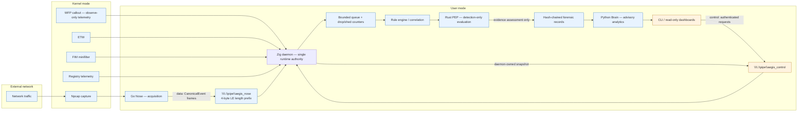
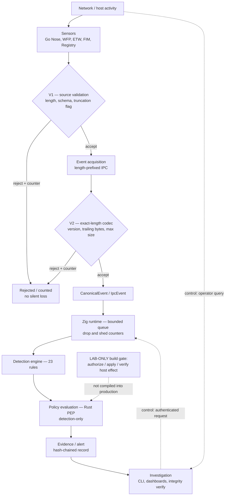
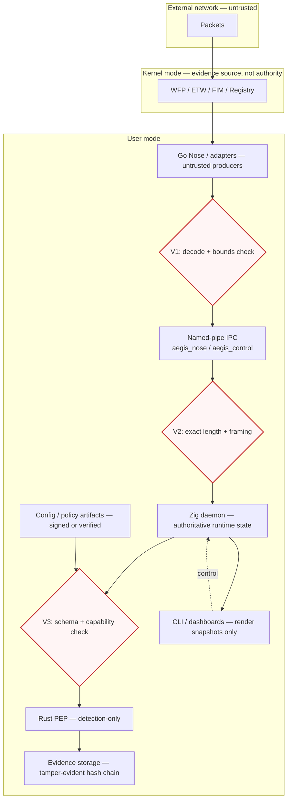

# AEGIS diagrams — component, lifecycle, trust boundary

> Scope: production `v1.1` observe-only runtime at build source `7822f4c`
> (prior `43a8bcc` scope is HISTORICAL).
> These diagrams describe source-described routes; they are not Windows E5 proof.
> Lab-only host-effect stages are labelled and are not part of production.
> Data flow and control flow use different edge styles. Validation points are marked `Vn`.

---

## Diagram 1 — Component architecture

Notes:

- Solid blue edges are **data/evidence flow**; orange edges are **control flow**.
- Go Nose is the canonical acquisition path. Direct Npcap in Zig is a disjoint
  lab-only sensor and never a second production ingress.
- The production WFP filter is observe-only telemetry. Block IOCTL returns
  `STATUS_NOT_SUPPORTED`; no production component authorizes a host effect.
- Rust PEP returns an assessment; a PEP decision or receipt is not evidence of a
  host effect (`RETIRE-HOST-EFFECT-001`, `AUTHORITY_MAP.json`).

---

## Diagram 2 — Event lifecycle (production)

Notes:

- Production stops after policy evaluation: the decision is recorded as evidence.
  Steps `authorize / apply / verify` exist only in the separately compiled lab gate.
- `V1` and `V2` are validation points. Rejections increment observable counters
  (`nose_frames_rejected`, `queue_drops`, shed counters); they are not silent.
- Event time (`timestamp_ms`, `monotonic_ns`) is preserved from the producer; the
  wall clock is used only for liveness, not to overwrite producer time.
- Known gap: R2003 (PowerShell cradle) has no `CommandLine` producer in v0–v4
  process telemetry, so it is catalogued but host-inert (FN-1).

---

## Diagram 3 — Trust boundary

Notes:

- Blue/orange distinction from Diagram 1 applies here as well: producer-to-runtime
  edges are data; operator-to-runtime edges are control.
- A malicious local process may open named pipes; authorization is enforced at
  `V3` by the Zig daemon. `provider_ready=true` is not a host-effect authorization
  and is projected as `host_effect_capable=false` in production.
- Kernel administrator or higher OS control is **outside** what a user-mode NIDS
  can defend. The system is tamper-evident, not tamper-proof. See
  [`docs/SECURITY_THREAT_MODEL.md`](../SECURITY_THREAT_MODEL.md).
- Evidence storage integrity is hash-chain verification after the fact; it is not
  replay re-execution and not a claim of "zero loss ever".

---

Source-of-truth pointers (do not duplicate their content here):

- Canonical event schema: `shared/event/canonical_event.md` (FROZEN)
- Wire framing: `shared/protocol/wire_v1.md`, `wire_v2.md`, `wire_v3.md` (ACTIVE)
- Authority: `AUTHORITY_MAP.json`, `docs/architecture/authority-matrix.md`
- Runtime contract: `docs/runtime/RUNTIME_CONTRACT.md`
