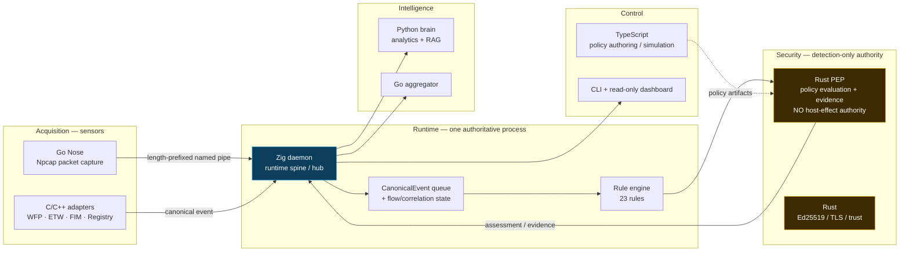

# AEGIS NIDS Windows — Architecture (English)

> Plain-language architecture explanation for engineers, operators, and reviewers.
> Facts are taken from the repository's current machine-readable maps (`SYSTEM_MAP.json`,
> `FLOW_MAP.json`, `AUTHORITY_MAP.json`, `CONTRACT_MAP.json`, `runtime_manifest.json`).
> Historical IPS/enforcement documents in the repo are explicitly **not** current truth.
> Caveat: `CONTRACT_MAP.json` CONTRACT-04 is stale v1 control-IPC metadata; current control-plane
> behavior comes from `src/control/protocol.zig` and `src/control/handler_registry.zig` (v2).
> See [Security boundaries](../architecture/SECURITY_BOUNDARIES.md) for source-cited details and
> [SOURCE_AUDIT-20261123.md](../../analysis/current-head/SOURCE_AUDIT-20261123.md) for the 2026-11-23
> read-only audit (E1/E2; no new build or host verification).

---

## 1. One-sentence model

AEGIS is a **Windows-native, kernel-assisted Network Intrusion Detection System** that turns
network and host activity into one canonical event format, matches it against 23 rules,
records a policy decision as evidence, and writes hash-chained forensic records — with a
hard rule that no component may turn "detected" into "blocked."

It is **detection-only**: findings are recorded and explained. Production host blocking,
quarantine, and WFP mutation are outside the product scope.

---

## 2. Shape of the system: hub and spoke, not a mesh



**The important design rule:** Zig is the hub; every other language is a spoke. Components do
not talk to each other in a free-for-all. They connect through the Zig runtime via C ABI or FFI.
This is what makes the six-language-family architecture auditable: there is one place where authority lives (C and C++ are two toolchains counted as one adapter family).

---

## 3. Who owns what

| Plane | Language | Owns | Deliberately does **not** own |
|---|---|---|---|
| Acquisition | Go (`nose/`) | Packet capture, decode, event serialization, named-pipe transport | Policy, enforcement |
| Acquisition | C/C++ (`src/windows/`, `bridge/`) | WFP / ETW / FIM / Registry telemetry adapters | Policy decisions, host effects |
| Runtime | Zig (`src/`) | Event queue, flow table, detection, correlation, forensics, dispatcher, control pipe | Privileged enforcement, crypto |
| Security | Rust (`rust-src/`) | Detection-only PEP evaluation, authorization *evidence*, Ed25519/TLS/trust | Host effects, WFP mutation, detection logic |
| Intelligence | Python (`brain/`) | Tier-2 analytics, RAG, correlation support | Privileged OS calls, enforcement |
| Control | TypeScript (`ts_policy/`) | Policy authoring, simulation, compiler | Runtime execution, enforcement |
| Performance | Cython | Measured Python hot loops only (after profiling) | New logic |

Rust compiles to `aegis_pep.dll` and is linked into the canonical detection path, but it is a
**detection-only policy/evidence authority**. The driver's block IOCTL returns
`STATUS_NOT_SUPPORTED`; there is no production path that can install an AEGIS-owned filter.

---

## 4. The production flow, end to end

The canonical flow in `FLOW_MAP.json` is `DATA-001 — Production IDS: Go Nose → Canonical Event →
Detection → Forensic Record → IDS Evidence Receipt`. Compressed to the steps that matter:

1. **Capture** — Go Nose reads frames from the selected Windows interface with Npcap.
2. **Normalize** — Each frame becomes a `CanonicalEvent`. The schema is frozen in
   `shared/event/canonical_event.md`; implementations exist in Zig, Go, C, and Python (plus a
   golden tuple-map), while the Rust codec is still marked TBD. The named-pipe frame is a
   **4-byte little-endian length prefix followed by the canonical frame**: v1 = 113 bytes on
   wire, v2 = 137 bytes, v3 = 169..1193 bytes (4 + 165-byte envelope + up to 1024-byte payload).
   See the [Canonical Event Schema](../CANONICAL_EVENT_SCHEMA.md) for field-level detail.
3. **Transport** — Frames cross `\\.\pipe\aegis_nose` into the Zig daemon. The recorded
   loopback binding is a self-test configuration, not the production default; no loopback TCP
   fallback is implemented in `nose/pipe_writer.go` (`dialPipe` uses the named pipe only).
4. **Flow & detect** — The Zig runtime maintains flow state and evaluates 23 rules across
   `L4`, `L7`, `KERNEL_FILE`, `KERNEL_PROCESS`, and `L2_PIPE`.
5. **Correlate** — Events are related into flows, processes, hosts, sessions, and incidents.
6. **Decide** — Policy maps evidence to `ALLOW / ALERT / ESCALATE / BLOCK_REQUESTED`.
7. **Assess (evidence only)** — The Rust PEP returns an assessment. A `BLOCK` request is reported
   as `ESCALATE` reason 8 with `filter_id = 0`; no host effect is authorized.
8. **Remember** — A forensic record is appended to a hash-chained, verified log; an IDS evidence
   receipt is produced; audit/decision traces record what happened.
9. **Present** — CLI, JSON snapshot API, and a read-only web dashboard show the authoritative
   state. The dashboard is a view, not a second supervisor.

Production stops at the decision/evidence boundary. The historical lab-only steps that once
validated a reversible WFP filter are retained as evidence contracts, not as a product feature.

---

## 5. The boundary that matters most

```
observed  →  normalized  →  detected  →  decision recorded  →  evidence receipt
                                        │
                                        └── NO host mutation, ever
```

This is enforced in several independent places:

- `prevention_gate = closed`, `tier3_enforcing = false`, `host_effect_capable = false`.
- No production command opens the prevention gate.
- A `BLOCK` policy label is **intent**, not proof of a block. Only a validated `EnforcementReceipt`
  with `status=ENFORCED` and `host_effect_confirmed=true` could support a block claim — and the
  production build cannot produce one.
- WFP host tests auto-enable only when a real PEP DLL and signed driver are present; they assert
  detection-only behavior and never weaken the invariant.

---

## 6. Why this is more than a rule engine

- **One schema, N codecs.** Changing the wire contract means updating every language codec plus
  the shared vector in the same patch. This is tested, not assumed.
- **Machine-readable truth.** `SYSTEM_MAP.json`, `FLOW_MAP.json`, `AUTHORITY_MAP.json` and friends
  are regenerated after each patch and checked against the build source commit. A records-only
  commit does not make them stale; a source change does.
- **Vertical slices.** Work is organized as one end-to-end flow at a time (event → forensic →
  sequence → hash → CRC → persistence → read → verify → replay → audit → CLI → evidence), not as
  isolated file edits.
- **Evidence levels E0–E7.** Claims are tagged by how they were proven. E7 in this repository means
  release signing/rebuild — **not** field/production deployment.
- **Fail-closed.** If the control plane, forensic integrity, or a required subsystem is unavailable,
  the system reports `DEGRADED` and stays observe-only. It never guesses success.

---

## 7. Verification posture (current, not aspirational)

- Published release `v1.1` is `SHIPPABLE (0/6 gates open)`; trust anchor unchanged; no re-key.
- Owner-run soak: `36.52 / 24.0 h PASS` with zero loss **during that specific recorded window**, `problems=[]`, loss/shed/drop counters all `0`.
- Release artifacts: `674/674` verified; signed `SHA256SUMS` digest
  `A053C048C8B373CF93E766D9C54F54D191B33D273627075A6121516591E4996C`.
- Windows E5 lab proof: bridged Kali → Windows attribution, R9006 SYN-burst detection with a
  10-port negative control, and a loopback full-path self-test (`127.0.0.2` → `127.0.0.1`,
  exact 5-tuple, `host_effect_confirmed=false`).
- Detection coverage is stated honestly: all 23 rules have synthetic observe-only fixtures;
  live positive-path proof is strongest on the L4 family (R9006). Known limitations (for example,
  process rows without command lines, and L7 payload rules needing a proxy sensor) are recorded,
  not hidden.

---

## 8. What this project deliberately does **not** claim

- It is not an IPS and does not block or quarantine in production.
- No Signed-IR promotion, EV/HLK driver, or Microsoft attestation is claimed.
- No fake soak PASS, no synthesized host evidence, no "all 23 detections live-proven."
- `v1.1` is immutable; no tag, artifact, signature, or key was rewritten for cosmetics.
- Loopback is a self-test binding, not the production default.
- Raw Windows E5 host artifacts remain local-only under `admin-evidence/`.

---

## 9. Suggested 90-second interview answer

> "AEGIS is a Windows kernel-assisted NIDS. The interesting part isn't a single detector — it's the
> architecture discipline. Zig is the runtime hub; Go captures packets, C/C++ adapters read WFP,
> ETW and file telemetry, Rust evaluates policy as a detection-only authority, Python does
> analytics, and TypeScript authors policy. Everything becomes one canonical event, flows through
> detection and correlation, and lands in a hash-chained forensic log with an evidence receipt.
> The hard constraint is that no layer can promote 'detected' into 'blocked' — the prevention gate
> is closed and a BLOCK label is only an intent. I proved the full path with real lab traffic and a
> negative control, and the release was signed, soak-tested for 36.5 hours, and shipped as
> detection-only."

---

*See also: [1-minute README](../../README.md) · [Demo script](DEMO.md) ·
[Resume project section](RESUME_PROJECT.md)*
